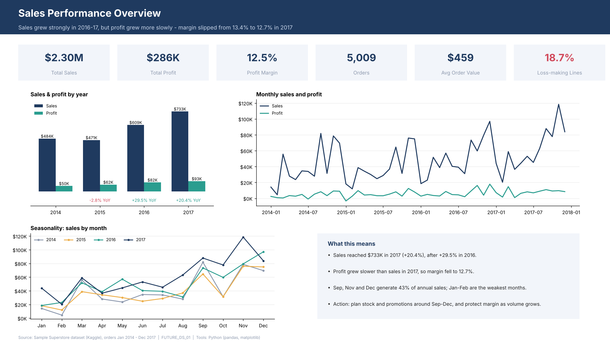
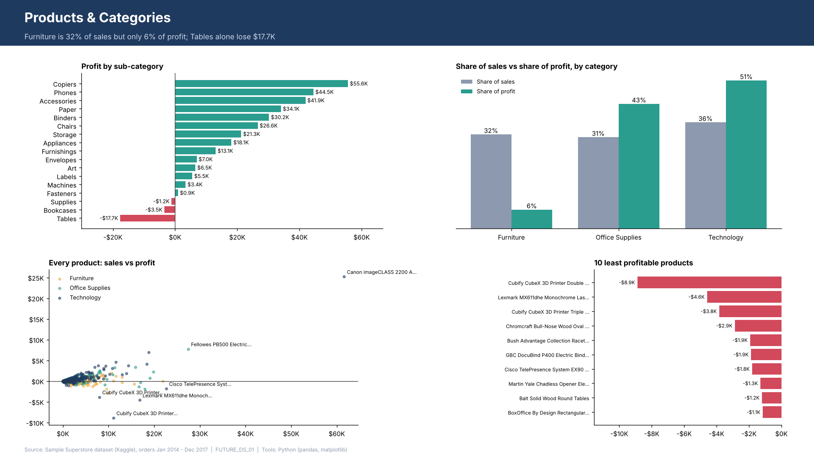
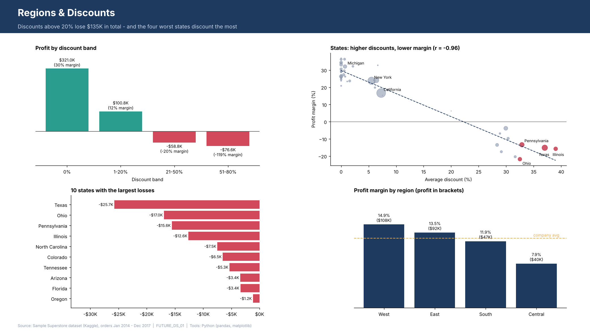

# FUTURE_DS_01 - Business Sales Performance Analytics

**Future Interns - Data Science & Analytics, Task 1** | Prepared by Shivaprasad
**Live - https://futureds01-kxk2xcpptxwlnbpackifio.streamlit.app/
## Business problem
A superstore wants to know which products, categories and regions drive revenue and profit, and where it should focus to grow faster. This project cleans the sales data, builds a 3-page dashboard, and turns the findings into recommendations.

## Dataset
[Sample Superstore](https://www.kaggle.com/datasets/vivek468/superstore-dataset-final) (Kaggle): 9,994 order lines, Jan 2014 - Dec 2017, one country (US), four regions. Not owned by me; used for educational purposes.

## Tools
Python (pandas, NumPy, matplotlib). An AI assistant (Claude) was used to help write and review the code and the first draft of this report; the analysis and numbers were checked against the data.

## Dashboard
Full 3-page PDF: [`dashboard/FUTURE_DS_01_dashboard.pdf`](dashboard/FUTURE_DS_01_dashboard.pdf)

| Overview | Products & Categories | Regions & Discounts |
|---|---|---|
|  |  |  |

## Data cleaning
Full log: [`docs/cleaning_log.md`](docs/cleaning_log.md). Summary:
- Loaded the file (not UTF-8, so tried common encodings): 9,994 rows x 21 columns.
- Standardised column names, trimmed whitespace, converted dates to datetime.
- Converted postal codes to 5-character text (numeric storage drops leading zeros).
- Removed 1 exact duplicate row. No missing values. No invalid dates, quantities, sales or discounts.
- Kept 1,870 loss-making order lines (18.7%): these are real losses, not errors.
- Found 32 product IDs mapped to more than one product name, so product rankings use product name.
- Added helper columns: order year/month, year-month, shipping days, profit margin.

## Headline KPIs
| Sales | Profit | Margin | Orders | Avg order value | Loss-making lines |
|---|---|---|---|---|---|
| $2.30M | $286K | 12.5% | 5,009 | $459 | 18.7% |

## Key insights
1. **Discounting is the biggest profit leak.** Lines with no discount earn a 29.5% margin and 1-20% discounts still earn 11.9%. Above 20% the business loses money: 21-50% discounts run at -19.7% margin and 51-80% at -119%. Discounts over 20% are only 13.9% of order lines but lose about **$135K** in total.
2. **Four states lose about $71K combined** (Texas -$25.7K, Ohio -$17.0K, Pennsylvania -$15.6K, Illinois -$12.6K). They discount heavily (32-39% average vs 15.6% overall), and every order line there carries a discount (36% elsewhere). Across all states, average discount and margin move almost one-for-one (r = -0.96).
3. **Furniture is 32% of sales but only 6% of profit.** Tables lose about $17.7K and Bookcases about $3.5K. Technology is 36% of sales and 51% of profit; Copiers, Phones and Accessories lead.
4. **Growth is strong but margin slipped.** Sales: $484K (2014), $471K (2015, -2.8%), $609K (2016, +29.5%), $733K (2017, +20.4%). Margin fell from 13.4% in 2016 to 12.7% in 2017.
5. **Sales are seasonal.** September, November and December are 43% of annual sales; January and February are weakest.
6. **Central is the weakest region** at a 7.9% margin vs 14.9% for West.

## Recommendations
1. **Cap discounts at about 20%** and require manager approval above that. This targets the ~$135K leak.
2. **Review discount rules in Texas, Ohio, Pennsylvania and Illinois first**, then Central overall.
3. **Reprice Tables and Bookcases or cut their discounts** before pushing more Furniture volume.
4. **Promote high-margin lines** (Copiers, Phones, Accessories, Paper) rather than discount-led products.
5. **Plan stock and campaigns around Sep-Dec**, and track margin monthly so growth does not erode profit.

## Limitations
The data is observational and covers one store group over four years, so the link between discounts and losses is strong but not proof of cause. Cost data is not available, so profit is taken as given. Product recommendations should be checked against stock and supplier context.

## How to reproduce
```bash
pip install -r requirements.txt
python scripts/01_clean_superstore.py   # needs the raw Kaggle file "Sample - Superstore.csv" in the working folder
python scripts/02_build_dashboard.py    # reads data/superstore_clean.csv, writes dashboard/ and images/
```

## Repository structure
```
FUTURE_DS_01/
├── README.md
├── requirements.txt
├── data/superstore_clean.csv
├── scripts/01_clean_superstore.py
├── scripts/02_build_dashboard.py
├── docs/cleaning_log.md
├── dashboard/FUTURE_DS_01_dashboard.pdf
└── images/page_1..3 PNGs
```


## Interactive app

An interactive version of the same 3-page dashboard built with Streamlit and Plotly.
Sidebar filters (Year, Region, Category) update all charts and KPIs in real time.

```bash
pip install -r requirements.txt
streamlit run app/streamlit_app.py
```

The app reads `data/superstore_clean.csv` relative to its own location, so it works from any working directory.
